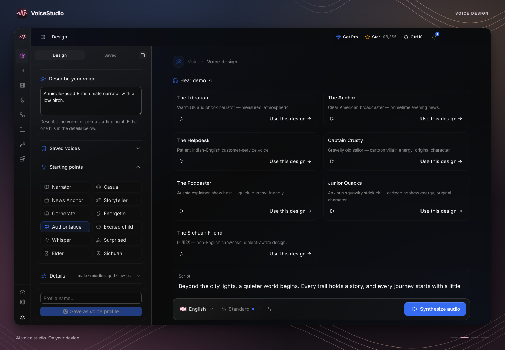
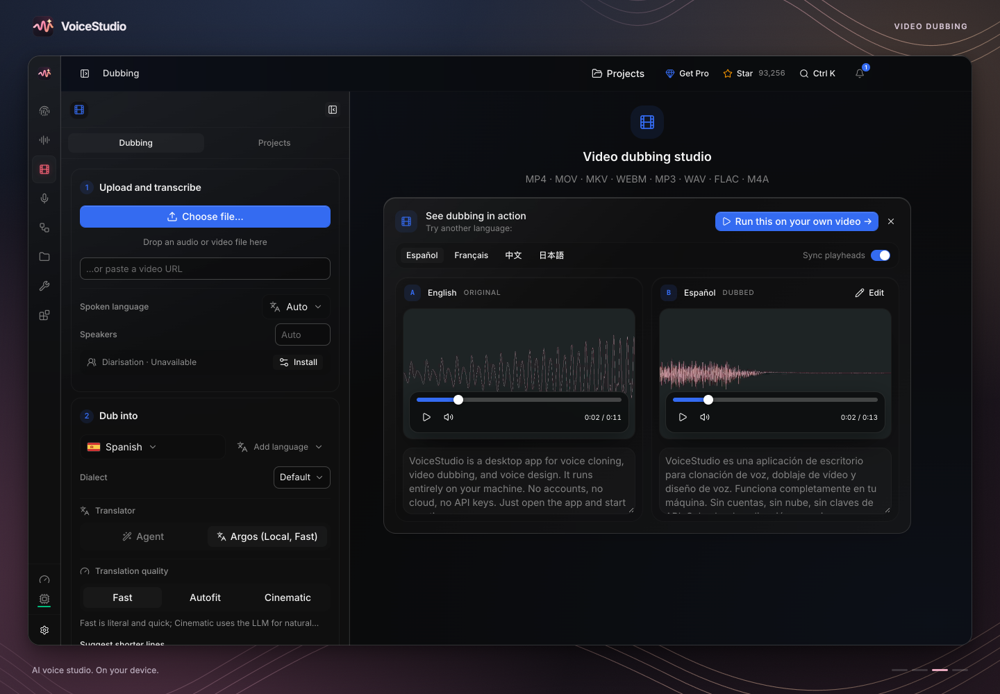
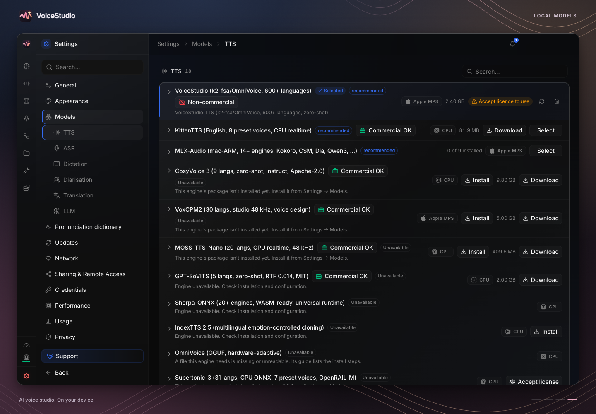
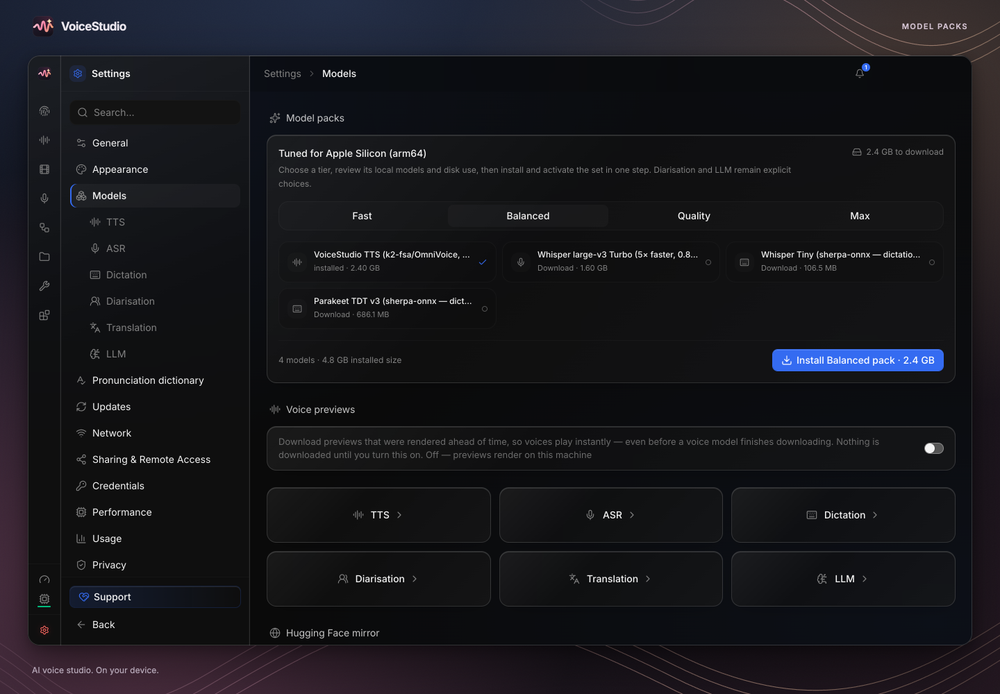

# VoiceBlueprintPro

**A local-first AI voice production suite focused on reliability, performance, accessibility, audio quality and professional workflows.**

VoiceBlueprintPro is DevTunaSoft's independent, open-source, local-first AI voice production studio for voice cloning, speech generation, dubbing, transcription and audiobook workflows.

[Features](#what-voiceblueprintpro-is) · [Get a development build](#try-a-development-build) · [How to use](#how-to-use-the-app) · [Beginner manual](docs/user-guide/README.md) · [Developer setup](#build-and-test-from-source) · [Documentation](docs/README.md) · [Roadmap](#our-direction) · [Build status](https://github.com/DevTunaSoft/VoiceBlueprintPro/actions) · [Releases](https://github.com/DevTunaSoft/VoiceBlueprintPro/releases) · [Credits](#open-source-credits-and-licensing)

[](https://github.com/DevTunaSoft/VoiceBlueprintPro/actions/workflows/ci.yml) [](LICENSE)

<p align="center">
  
  <br />
  <sub>Development interface preview; the current build may differ.</sub>
</p>

> [!IMPORTANT]
> **Actively in development; no official VoiceBlueprintPro release is published yet.** Supported release targets are **Windows desktop (x64; ARM64 experimental) and Android**. macOS, Linux and iOS are not maintained release targets. Windows x64 and experimental Windows ARM64 packaging have passed automated acceptance, but real-hardware production acceptance remains outstanding. See [releases](https://github.com/DevTunaSoft/VoiceBlueprintPro/releases) and [live GitHub Actions](https://github.com/DevTunaSoft/VoiceBlueprintPro/actions). Use builds and releases from this repository; external downloads are not official VoiceBlueprintPro distributions.

## What VoiceBlueprintPro is

A local-first AI speech and voice-production application. The codebase includes voice cloning and design, transcription, dubbing, narration and audiobooks, model management, queued jobs, and automation. Actual capabilities depend on installed engines, hardware, platform, model licenses and configuration.

Our mission is to deliver reliable, efficient and accessible voice production without unnecessary rewrites.

## Inside the studio

<p align="center">
  <sub>Actual screenshots retained with this codebase, illustrating the Electron desktop interface. VoiceBlueprintPro's modernization work is ongoing, so visual details in current development builds may differ.</sub>
</p>

<table>
  <tr>
    <td width="50%" valign="top">
      <a href="docs/media/electron/voice-cloning.png"></a><br />
      <strong>Voice cloning</strong><br />
      Prepare authorized reference audio, configure speech generation and review takes.
    </td>
    <td width="50%" valign="top">
      <a href="docs/media/electron/voice-design.png"></a><br />
      <strong>Voice design</strong><br />
      Explore text-guided voice creation with supported local models.
    </td>
  </tr>
  <tr>
    <td width="50%" valign="top">
      <a href="docs/media/electron/dubbing.png"></a><br />
      <strong>Video dubbing</strong><br />
      Prepare, review and export language and voice replacement workflows.
    </td>
    <td width="50%" valign="top">
      <a href="docs/media/electron/models.png"></a><br />
      <strong>Local models</strong><br />
      Discover and manage engines and model downloads according to your hardware.
    </td>
  </tr>
</table>

<details>
<summary><strong>More interface screenshots</strong></summary>

[](docs/media/electron/model-packs.png)

</details>

## Our direction

| Focus | What we're working toward |
| --- | --- |
| **Reliable generation** | Crash-safe jobs, checkpointing, predictable cancellation, safe recovery and project integrity |
| **Performance** | Measured startup and inference improvements, intelligent CPU/GPU memory management and model loading |
| **Audio quality** | Quality inspection, pronunciation tools, speech-to-script verification and selective regeneration |
| **Professional production** | Better audiobook, dubbing, editing, voice-directing and export workflows |
| **Automation** | Integrated production pipelines, reusable recipes, actionable diagnostics and accessible controls |
| **Trust and openness** | Consent-aware voice use, local-first processing, clear licensing, third-party credit and reproducible builds |
| **Engineering quality** | Fuzzing, fault injection, Windows/Android regression tests, real-audio verification and honest release gates |

**Planned does not mean implemented.** See the [consolidated capability program](#our-direction) for the complete backlog and verification standards.

## Development progress

We are strengthening the desktop application through code review, regression coverage, security hardening, fault injection, packaging tests and documentation.

- Active engineering changes are committed to `main`, including runtime stability improvements, test contracts and security hardening. CI may still contain legacy platform checks while the Windows/Android scope is being finalized.
- On November 7, 2026, [packaging run #42420264814](https://github.com/DevTunaSoft/VoiceBlueprintPro/actions/runs/42420264814) passed all five packaging jobs: **Windows x64, Windows ARM64, Linux x64, macOS Apple Silicon and macOS Intel**. The three supported voice-runtime dependency builds also passed. The Windows jobs exercised packaged startup and isolated local-runtime installation.
- [Full development CI #42420294120](https://github.com/DevTunaSoft/VoiceBlueprintPro/actions/runs/42420294120) passed on commit `ee379096`: Electron, Python, desktop UI, UI crawlers, renderer tests, installer contracts and platform smoke checks.
- **Windows ARM64 remains experimental** despite that passing CI run; it uses emulated x64 Python 3.11 and CPU inference, and has not yet been validated on representative physical ARM64 devices.
- **Outstanding release gates:** reproducible installation and uninstall on real hardware, audio input/output, real-model generation, GPU compatibility, long-running sessions, recovery and signing/distribution validation. The project currently has no published stable release.

A passing automated build is **not** a claim of a stable release or universal hardware compatibility.

## Existing functionality and technical guides

These guides describe VoiceBlueprintPro development workflows. Features and installation instructions may vary by build; consult the verification status before relying on them.

| Area | Documentation |
| --- | --- |
| Voice design and cloning | [Voice design](docs/voice-design.md) · [Audio quality](docs/audio-quality.md) |
| Transcription and dictation | [Transcriptions](docs/electron-transcriptions.md) · [Dictation](docs/features/dictation.md) |
| Video dubbing | [Dubbing](docs/electron-dubbing.md) · [Multi-speaker guide](docs/dubbing/multi-speaker-guide.md) |
| Audiobooks and projects | [Long-form narration](docs/electron-longform.md) · [Projects](docs/electron-projects.md) |
| Models and engines | [Engine guides](docs/engines/README.md) · [Model downloads](docs/downloading-models.md) |
| Automation | [Local API](docs/speech-platform.md) · [MCP](docs/mcp.md) |
| Developer reference | [Architecture](docs/STRUCTURE.md) · [Development documentation](docs/README.md) |

## Try a development build

There is **no signed, stable VoiceBlueprintPro installer yet**. Technically experienced testers can inspect and try CI-generated artifacts:

1. Open the [Electron packaging workflow](https://github.com/DevTunaSoft/VoiceBlueprintPro/actions/workflows/electron-build.yml).
2. Choose a completed run and confirm the **package job for your exact operating-system architecture** passed. Inspect individual jobs even when the overall workflow is green; experimental jobs may not affect the overall result.
3. Under **Artifacts**, download `electron-rehearsal-win32-x64` for Windows x64 or `electron-rehearsal-win32-arm64` for Windows ARM64, if available. Sign-in may be required. Extract the ZIP and locate the installer or packaged application.
4. Run only artifacts from this repository that you trust. Development builds may be unsigned. Do not turn off operating-system protections solely to run a build.
5. On first launch, follow the local-runtime setup prompts, then obtain any speech models you want to use. Initial installation needs internet access, sufficient disk space and the correct permissions.

[Windows x64 and ARM64 packaging artifacts](https://github.com/DevTunaSoft/VoiceBlueprintPro/actions/runs/42420264814) were generated on November 7, 2026. CI artifacts expire, so use a newer successful run if unavailable. Windows ARM64 remains experimental and uses an emulated x64 Python backend with CPU inference.

When a stable version is published, use the [VoiceBlueprintPro releases page](https://github.com/DevTunaSoft/VoiceBlueprintPro/releases), and consult the [Windows installation guide](docs/install/windows.md) for current setup guidance.

## How to use the app

After the runtime and appropriate models are installed:

1. **Clone:** select or record permitted reference speech, enter your script, choose an engine, generate, preview and export.
2. **Voice design:** describe the desired voice, choose a compatible model and generate a sample.
3. **Transcription and dictation:** provide an audio file or microphone input and review the speech-to-text output.
4. **Dubbing:** import a video, configure source/target language and voice options, generate and check the resulting video before export.
5. **Stories and audiobooks:** create longer narration, review sections and manage output or projects.
6. **Model management and automation:** download supported local models, manage projects, and explore the local API, recipes and integrations.

For a guided walkthrough, use the [VoiceBlueprintPro beginner's manual](docs/user-guide/README.md). The app's available workflows depend on the build, operating system, installed engines, model licenses and available CPU/GPU resources. Start with the [feature catalog](docs/feature-catalog.md), [model download guide](docs/downloading-models.md), [Electron app instructions](electron/README.md) and [documentation index](docs/README.md). Offline inference is possible with compatible local engines after their model files have been downloaded. Optional online services remain separate.

## Build and test from source

This repository retains established compatibility identifiers and development tooling. These commands are **developer workflows**, not a claim that an independently packaged VoiceBlueprintPro installer is available.

**Prerequisites:** Git, Bun 1.4.2, a supported Python runtime and the platform-specific build tools described in the [development documentation](docs/README.md). Active development and the current codebase are on `main`.

```sh
git clone https://github.com/DevTunaSoft/VoiceBlueprintPro.git
cd VoiceBlueprintPro
bun install
bun run typecheck
bun run lint
bun run test
bun run build
```

For Python tests, use the repository's existing `uv` environment and test instructions. See [CI](.github/workflows/ci.yml) for the current verification jobs. Not all native, GPU or installer tests can run on every development machine.

## No duplicate implementations

Before adding features, we search the entire repository for existing code, APIs, data structures, tests and documentation. We then **reuse and improve the authoritative implementation** wherever possible. The repository already contains job queues, model management, audio-quality tools, voice profiles, project bundles and performance services; their completeness is being audited.

Every substantive change should include a reproducible test, regression verification, multiple distinct fault/fuzz scenarios where appropriate, and a record of remaining risks. We do not claim an application is error-free or production-ready without supporting evidence.

## Open source, credits and licensing

VoiceBlueprintPro is an independent DevTunaSoft project. It is distributed under AGPL-3.0-only, subject to the repository's LICENSE and NOTICE. Components and model weights may carry separate restrictions and rights; review applicable licenses before distribution or commercial use.

Historical copyright and third-party attribution must remain intact where required by law and licenses. These acknowledgments do not imply sponsorship, partnership or affiliation with prior projects.

## Contributing and reporting issues

We welcome fixes, tests, documentation, accessibility improvements, and new ideas that build on existing work.

- [Submit a reproducible fix or enhancement as a pull request](https://github.com/DevTunaSoft/VoiceBlueprintPro/pulls)
- [Review development changes](https://github.com/DevTunaSoft/VoiceBlueprintPro/pulls)
- [Contribution review standards](.github/pull_request_template.md)
- [Development roadmap](#our-direction)

**Issues and Discussions are currently disabled.** Follow the [security policy](.github/SECURITY.md) to report vulnerabilities privately rather than disclosing exploitable details.

---

*VoiceBlueprintPro · Design. Clone. Create. · DevTunaSoft*
